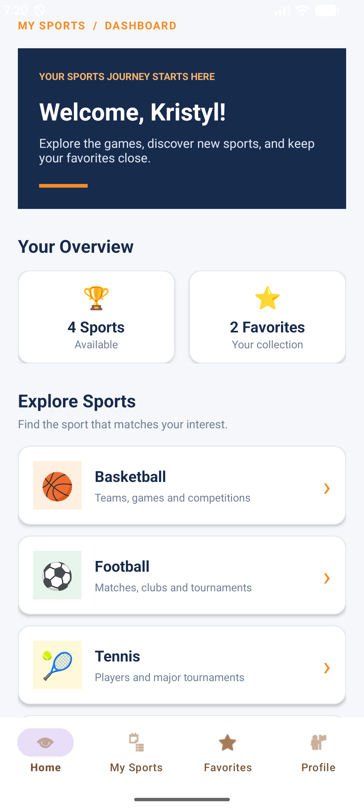
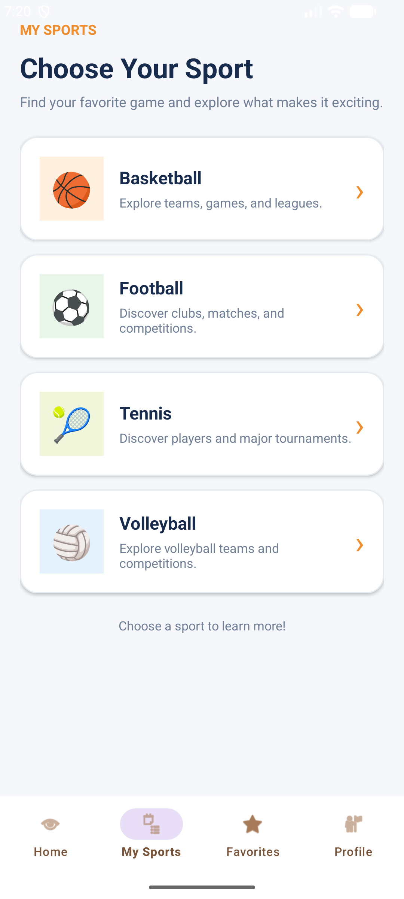
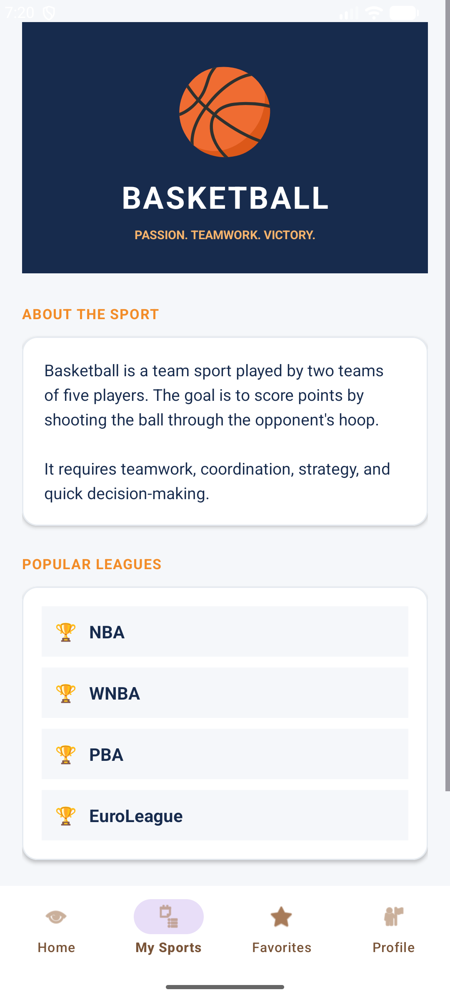
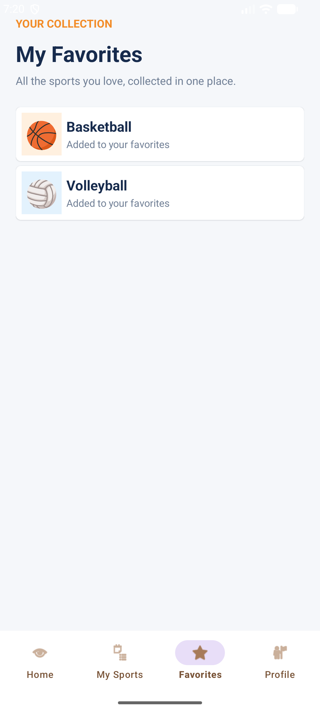
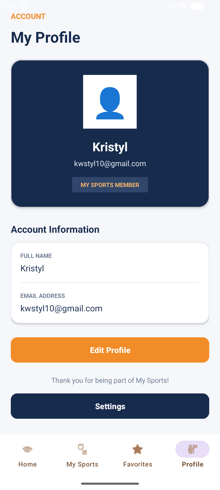

# 🏅 My Sports Android App

My Sports is a simple Android application developed using **Kotlin** and **XML** in Android Studio. It allows users to explore different sports, view individual sports pages, and save their favorite sports in one place.

## 📱 Features

- **Home** – Displays a welcome screen and a summary of favorite sports.
- **My Sports** – Browse four different sports.
- **Sports Details** – View individual pages for Basketball, Football, Tennis, and Volleyball.
- **Favorites** – Add or remove sports from your favorites list.
- **Profile** – View and edit your name and email address.
- **Settings** – View application information and help details.
- **Bottom Navigation** – Easily navigate between Home, My Sports, Favorites, and Profile.

## 🏀 Available Sports

- Basketball
- Football
- Tennis
- Volleyball

## 🛠️ Technologies Used

- **Language:** Kotlin
- **UI Design:** XML
- **IDE:** Android Studio
- **Navigation:** Android Navigation Component
- **UI Components:** Material Design Components
- **Local Storage:** SharedPreferences

## 📂 Project Structure

```text
MySports/
├── app/
│   └── src/
│       └── main/
│           ├── java/com/example/mysports/
│           │   ├── sports/
│           │   ├── HomeFragment.kt
│           │   ├── MySportsFragment.kt
│           │   ├── FavoritesFragment.kt
│           │   ├── ProfileFragment.kt
│           │   ├── SettingsFragment.kt
│           │   └── MainActivity.kt
│           └── res/
│               ├── layout/
│               ├── navigation/
│               ├── menu/
│               └── drawable/
├── build.gradle.kts
└── settings.gradle.kts
```

## 🚀 Getting Started

1. Clone this repository:

   ```bash
   git clone https://github.com/KristylPeyt/MySports.git
   ```

2. Open Android Studio.
3. Select **Open** and choose the cloned `MySports` folder.
4. Allow Gradle to sync.
5. Run the application using an Android emulator or compatible Android device.


## 📌 Project Information

My Sports is an educational project created to practice Android application development, Kotlin programming, XML interface design, and navigation between screens.

## 📱 App Screenshots

<p align="center">
  
  
  
  
  
</p>
